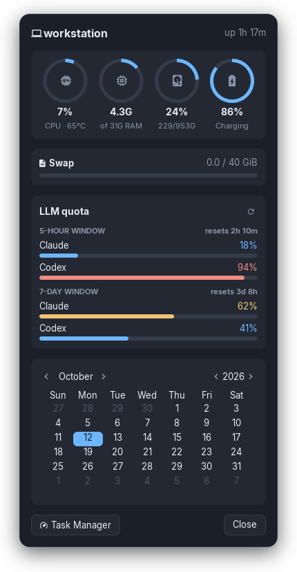
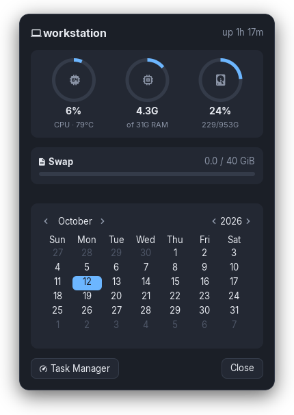

# eww-sysstat

A compact system popup for [Eww](https://github.com/elkowar/eww): CPU, RAM, disk and battery rings, swap, an optional LLM-quota card, and a calendar. It opens from a panel clock, a hotkey, or anything else that can run a command.


| Full | Minimal (no quota endpoint, no battery) |
|:---:|:---:|
|  |  |

Endpoints, tokens and host names are kept out of the Eww config. Everything machine-specific comes from a `.env` file, which is parsed and never executed. Leave a setting unset and its card either hides or falls back to an auto-detected value.

## Contents

- [Features](#features)
- [Requirements](#requirements)
- [Install](#install)
- [Configuration](#configuration)
- [Opening the popup](#opening-the-popup)
- [LLM quota endpoint](#llm-quota-endpoint)
- [Theming](#theming)
- [Running as a service](#running-as-a-service)
- [Layout](#layout)
- [Screenshots](#screenshots)
- [Troubleshooting](#troubleshooting)

## Features

- **Ring gauges** for CPU (with temperature), RAM, root disk and battery. Rings turn amber at 70% and red at 90%. The battery ring warns only while discharging, at 30% and 15%.
- **Btrfs-correct disk usage** via `statvfs`, because Eww's built-in `EWW_DISK` misreports Btrfs.
- **Battery from sysfs.** `EWW_BATTERY` reports 0% on some ThinkPads. With no battery present, the ring is hidden.
- **Swap bar**, hidden when there is no swap.
- **LLM quota card** with 5-hour and 7-day windows, coloured bars (blue <50%, amber <90%, red ≥90%), the time to the next reset, a per-row tooltip and a manual refresh button. Hidden unless `LLM_USAGE_URL` (or a fixture) is set.
- **Calendar** styled to match.
- **Task Manager** button that opens whichever system monitor is installed, or the one you configure.
- **Multiple instances.** `--id` opens independent copies, e.g. one by the clock and one beside a launcher menu.

## Requirements

| Need | Notes |
|---|---|
| Eww ≥ 0.6 (X11 build) | Uses `defwindow` arguments and `--arg`. Wayland builds work too; adjust `:stacking`. |
| Python ≥ 3.10 | Standard library only. |
| A Nerd Font | Icons use [JetBrainsMono Nerd Font](https://www.nerdfonts.com/). |
| Inter (optional) | Body font; falls back to the default sans. |
| bash | For `sysstat-toggle`. |

## Install

```sh
git clone <this repo> ~/.config/eww-sysstat
cd ~/.config/eww-sysstat
cp .env.example .env        # edit as needed; .env is git-ignored
eww -c ~/.config/eww-sysstat daemon
./sysstat-toggle
```

The `-c` path keeps this config separate from any existing `~/.config/eww`, so it can run alongside another Eww setup. Each config directory gets its own daemon.

On NixOS / Home Manager, point `programs.eww.configDir` at a checkout. Then either put `.env` next to it (it can't live in the read-only store), or set `EWW_SYSSTAT_ENV` in the daemon's environment.

## Configuration

Settings are read from, in order of precedence:

1. the process environment, so `KEY=value ./sysstat-toggle` works for one-offs;
2. the file at `$EWW_SYSSTAT_ENV`, if set;
3. `.env` next to `eww.yuck`.

The file is parsed line by line (`KEY=value`, optional `export`, optional quotes, `#` comments), never `source`d. See [`.env.example`](.env.example) for the full annotated list.

| Variable | Default | Purpose |
|---|---|---|
| `LLM_USAGE_URL` | *(empty → card hidden)* | Usage endpoint, e.g. `https://gateway.example.com/v1/usage` |
| `LLM_USAGE_TOKEN` | — | Bearer token |
| `LLM_USAGE_TOKEN_FILE` | — | Read the token from the first line of this file instead |
| `LLM_USAGE_TIMEOUT` | `5` | HTTP timeout, seconds |
| `LLM_USAGE_PROVIDERS` | — | Display renames: `anthropic=Claude,openai-codex=Codex` |
| `LLM_USAGE_FIXTURE` | — | Render a saved JSON payload instead of calling HTTP |
| `SYSSTAT_HOSTNAME` | machine hostname | Header label |
| `SYSSTAT_DISK_PATH` | `/` | Filesystem for the disk ring |
| `SYSSTAT_CPU_SENSOR` | first of `k10temp`, `coretemp`, `zenpower`, `cpu_thermal` | hwmon driver for CPU temperature |
| `SYSSTAT_BATTERY` | first `BAT*` | `power_supply` name; a non-existent name hides the ring |
| `SYSSTAT_TASK_MANAGER` | first installed monitor | Command for the Task Manager button |
| `SYSSTAT_ANCHOR` | `bottom right` | Window anchor |
| `SYSSTAT_X` / `SYSSTAT_Y` | `-10px` / `-44px` | Offset from the anchor |
| `EWW_BIN` | `eww` | Eww executable used by `sysstat-toggle` |

Keep secrets out of `.env` if you share it: put the token in a `chmod 600` file and set `LLM_USAGE_TOKEN_FILE`.

## Opening the popup

`sysstat-toggle` reads placement from `.env` and passes it to Eww as window arguments:

```sh
./sysstat-toggle              # toggle (default)
./sysstat-toggle open
./sysstat-toggle close
./sysstat-toggle --id menu    # a second, independent instance
```

**XFCE panel clock.** Set the clock plugin's command:

```sh
xfconf-query -c xfce4-panel -p /plugins/plugin-<N>/command -s "$HOME/.config/eww-sysstat/sysstat-toggle"
```

**Beside the Whisker menu** on a bottom-left panel, using a second instance:

```sh
SYSSTAT_ANCHOR="bottom left" SYSSTAT_X=462px ./sysstat-toggle --id menu
```

**Hotkey.** Bind any shortcut to the script path. In i3/sway: `bindsym $mod+s exec ~/.config/eww-sysstat/sysstat-toggle`.

## LLM quota endpoint

The card expects `GET $LLM_USAGE_URL` to return JSON shaped like this (extra fields are ignored):

```json
{
  "reports": [
    {
      "provider": "anthropic",
      "limits": [
        {
          "label": "5 hours",
          "status": "ok",
          "window": { "id": "5h", "resetsAt": 1791848241000 },
          "amount": { "usedFraction": 0.18 }
        }
      ]
    }
  ]
}
```

- `window.id` must be `5h` or `7d`; other windows are ignored.
- `resetsAt` is epoch milliseconds.
- Usage is read from the first of `amount.remainingFraction`, `amount.usedFraction`, or `amount.used`/`amount.limit`.
- When several reports share a provider and window (multiple accounts), the tightest one is shown.
- Errors show inline: `token rejected` for HTTP 401/403, `endpoint` for anything else. A script failure still prints a valid fragment, so Eww never ends up with an unparsable widget.

[`docs/fixtures/usage.json`](docs/fixtures/usage.json) is a working example. Set `LLM_USAGE_FIXTURE` to it to style the card offline.

## Theming

All colours are variables at the top of [`eww.scss`](eww.scss):

```scss
$bg: #1b1f27;   $card: #232833;  $border: #343b49;
$fg: #e6e9ef;   $muted: #8a93a5; $track: #343b49;
$ok: #6cb6ff;   $warn: #f0c674;  $crit: #f28b82;
```

Two things to know about Eww's GTK CSS:

- `* { all: unset; }` at the top stops the GTK theme leaking into the popup. Remove it if you want the popup to follow your GTK theme.
- `line-height` is not supported; Eww rejects the whole stylesheet if it appears.

## Running as a service

[`contrib/eww-sysstat.service`](contrib/eww-sysstat.service) is a systemd user unit:

```sh
cp contrib/eww-sysstat.service ~/.config/systemd/user/
systemctl --user enable --now eww-sysstat
```

User services start with a minimal `PATH`. Without `python3` on it, every poll fails silently and the popup shows "Disk unavailable", so the unit sets `PATH` explicitly. Adjust it for your distro.

## Layout

```
eww.yuck              widgets and window (no secrets, no endpoints)
eww.scss              styles
sysstat-toggle        open/close/toggle with placement from .env
.env.example          every setting, documented
scripts/
  sysstat_env.py      shared .env loader (environment > file)
  system-info         host, uptime, CPU temperature, battery → JSON
  disk-usage          statvfs disk usage → JSON
  llm-usage           quota endpoint → Yuck fragment
  task-manager        launches the configured system monitor
contrib/              systemd user unit
docs/fixtures/        demo quota payload
docs/images/          README screenshots
tools/screenshot      regenerates docs/images headlessly
```

## Screenshots

`tools/screenshot` renders the images on a private Xvfb display with a private Eww IPC socket. Your running desktop and Eww daemon are untouched. It uses the demo fixture and ignores any real `.env`.

```sh
# Needs Xvfb, xwininfo and ImageMagick 7. On Nix:
nix shell nixpkgs#xorg.xorgserver nixpkgs#xorg.xwininfo nixpkgs#imagemagick -c \
  env SCREENSHOT_WALLPAPER=~/Pictures/wallpaper.png tools/screenshot
```

## Troubleshooting

| Symptom | Cause / fix |
|---|---|
| "Disk unavailable", no quota card, empty header | Poll scripts aren't running, usually because `python3` isn't on the daemon's `PATH`. Check `journalctl --user -u <unit>` for `/usr/bin/env: 'python3'`. |
| Quota card missing | `LLM_USAGE_URL` is empty; that's expected. Run `./scripts/llm-usage` to see what Eww receives. |
| "token rejected" | The endpoint returned 401/403; check `LLM_USAGE_TOKEN(_FILE)`. |
| Icons render as boxes | Install a Nerd Font and check `fc-match "JetBrainsMono Nerd Font"`. |
| Popup in the wrong place | Set `SYSSTAT_ANCHOR`/`SYSSTAT_X`/`SYSSTAT_Y`. Offsets are relative to the anchor; negative values move left or up from the right or bottom edges. |
| Daemon stops responding | `eww -c <dir> kill`, delete stale `$XDG_RUNTIME_DIR/eww-server_*` sockets, then start the daemon again. |

Any script can be run by hand to see exactly what Eww gets:

```sh
./scripts/system-info; ./scripts/disk-usage; ./scripts/llm-usage
```

## License

MIT, see [LICENSE](LICENSE).
